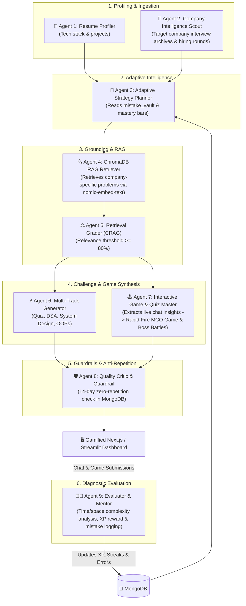

# 🎮 PlacementPilot: Interactive Gamified Multi-Agent Platform & Architecture Spec

> **Core Concept:** Transform static placement prep into an interactive, gamified daily battleground. The platform dynamically extracts conversational context, interview answers, and resume insights from chat transcripts to generate live **Gamified Speed Quizzes**, **Company Boss-Fights**, and **Interactive Coding Duels**, powered by 9 collaborative autonomous agents.

---

## 🏛️ 1. Multi-Agent Ecosystem (Now with GameEngine & Company Agents)

To deliver continuous interactive games from chat history and target company patterns, the system is upgraded to **9 Specialized Agents**:

---

## 🤖 2. Detailed Breakdown of the 9 Agents

| # | Agent Name | Primary Mission | Interactive Gamification Role |
| :--- | :--- | :--- | :--- |
| **1** | **Resume Profiler** | Parses candidate resume PDF/Markdown | Builds player profile (Character Class: e.g., "Full-Stack Sorcerer", "Systems Paladin"). |
| **2** | **Company Scout** | Pulls real interview patterns for selected company targets (Google, Amazon, Microsoft, Uber, Flipkart, Swiggy) | Unlocks **"Company Boss Battles"** with branded company badges and company-specific rounds. |
| **3** | **Strategy Planner** | Analyzes mistake logs and skill radar | Sets today's difficulty dungeon level (Level 1 to Level 5) based on historical XP. |
| **4** | **ChromaDB Retriever** | Semantic search with `nomic-embed-text` | Retrieves historical company archives and tricky edge cases from vector store. |
| **5** | **Retrieval Grader** | Corrective RAG (CRAG) quality gate | Validates ground-truth accuracy before challenges are dispatched to the game engine. |
| **6** | **Multi-Track Generator** | Constructs standard 4 daily tracks | Generates Core CS, DSA, System Design, and OOPs challenges. |
| **7** | **Interactive Game Master** *(NEW!)* | **Extracts live chat conversations & answers** | **Converts conversational mistakes into a Rapid-Fire 60-Second Trivia Game, Flashcard Duels, and Boss Fights.** |
| **8** | **Quality Critic** | Zero-repetition filter | Guarantees no duplicate questions within rolling 14 days by querying MongoDB. |
| **9** | **Evaluator & Mentor** | Code analysis & constructive feedback | Awards **XP, Gold coins, Daily Streak shields**, and writes failures to `mistake_vault`. |

---

## 🕹️ 3. Interactive Gamification Mechanics (How Chat Turns Into a Game)

### A. The "Chat-to-Game" Extraction Loop (Agent 7)
1. **Live Chat Monitoring:** While chatting with the AI about concepts (e.g., *"Explain why Redis is single-threaded"* or *"How does Dijkstra algorithm work?"*), Agent 7 extracts:
   - Key terminology mentioned.
   - Misconceptions or hesitation detected in your messages.
2. **Instant Mini-Game Trigger:** Agent 7 pops up an interactive **60-Second Sudden Death Trivia**:
   - 4 rapid-fire MCQs based directly on the discussion you just had!
   - 10-second timer per question with sound effects & dynamic score multiplier.

### B. "Company Boss Battles" (Target Company Simulation)
- Candidate selects a target company icon (Google 🟢, Amazon 🟠, Microsoft 🔵, Meta 🔷, Uber ⚫).
- **Stage 1 (OA Qualifier):** 2 Speed MCQs + 1 Timed DSA problem.
- **Stage 2 (Technical Round):** Interactive conversational system design battle against the AI Interviewer.
- Defeating the boss unlocks verified company readiness badges for your portfolio!

### C. RPG Progression & Skill Radar
- **Skill Points (XP):** Earn XP for correct solutions, clean code complexity ($O(N)$ vs $O(N^2)$), and daily streaks.
- **Dynamic Mastery Radar:** Real-time spider chart in the UI showing progress across DBMS, OS, Computer Networks, DSA, and System Design.

---

## 🛠️ 4. Tech Stack With Icon Legend

| Tool / Technology | Icon Category | Implementation Role |
| :--- | :--- | :--- |
| **LangGraph** | 🦜🕸️ Orchestrator | Graph state-machine managing cyclical multi-agent handoffs & game loops. |
| **LangChain** | 🦜🔗 Middleware | Prompt formatting, vector retrieval chains, and document loaders. |
| **Llama 3.2 3B** | 🦙 Local Brain | Local inference via Ollama, 100% offloaded to NVIDIA RTX 2050 (4 GB VRAM). |
| **nomic-embed-text**| 📐 Embeddings | High-dimensional semantic vectorizer running locally on Ollama. |
| **ChromaDB** | 🗄️ Vector DB | In-process vector store housing company interview archives. |
| **MongoDB** | 🍃 State & Memory | Stores candidate stats, XP, question logs, and mistake vaults. |
| **MongoDB Compass** | 🧭 Admin Inspector | Real-time desktop GUI to inspect live candidate collections and game states. |
| **NVIDIA RTX 2050** | ⚡ Hardware Accel | 4GB GDDR6 VRAM enabling 20–35 tokens/sec local LLM inference. |
| **Streamlit / Next.js**| 💻 Game UI | Interactive frontend supporting live timers, code editors, and animated scoreboards. |
