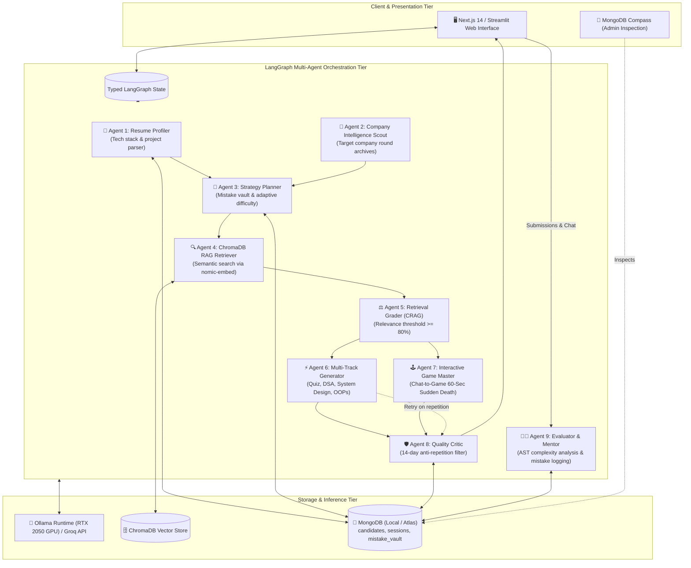
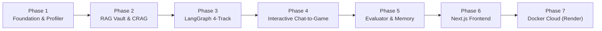

# 📄 Software Requirements Specification (SRS) & 7-Phase Implementation Plan
## PlacementPilot: Autonomous Resume-Adaptive Agentic RAG Placement Coach

---

## 1. Executive Summary & Architecture Paradigm

**PlacementPilot** is a production-grade, multi-agent Retrieval-Augmented Generation (RAG) platform tailored for technical placement preparation. The platform analyzes candidate resumes, connects to historical company interview archives, dynamically generates four tailored daily preparation tracks (CS Fundamentals, Coding DSA, Resume-Grounded System Design, and OOPs/Design Patterns), and runs interactive gamified battlegrounds.

### Hybrid Microservices Evolution Strategy:
- **Phases 1–6 (Local Development on Laptop):** Zero-friction, bare-metal execution utilizing the local **NVIDIA GeForce RTX 2050 (4 GB VRAM)** via **Ollama (`llama3.2:3b` + `nomic-embed-text`)**, **ChromaDB**, and **local MongoDB (viewed via MongoDB Compass)**. Consumes minimal system RAM (~500 MB) with zero Docker virtualization overhead.
- **Phase 7 (Production Cloud Deployment):** Containerized microservices deployment onto **Render (Docker Cloud)** integrated with **MongoDB Atlas Free Tier** and ultra-fast cloud inference via **Groq Cloud API (`llama-3.3-70b`) / OpenAI**, providing a live public URL with 0 MB laptop resource consumption.

---

## 2. Updated Technology Stack Matrix

| Layer / Role | Local Development (Phases 1–6) | Cloud Production (Phase 7 - Render) |
| :--- | :--- | :--- |
| **Agentic Orchestrator** | **LangGraph + LangChain** (Python 3.11) | **LangGraph** inside Docker (Python 3.11-slim) |
| **Primary LLM Engine** | Local `llama3.2:3b` on **RTX 2050 GPU (VRAM)** via Ollama | **Groq API (`llama-3.3-70b-versatile`)** / `gpt-4o-mini` |
| **Embedding Engine** | `nomic-embed-text` (Local via Ollama GPU/CPU) | `nomic-embed-text` / OpenAI `text-embedding-3-small` |
| **Vector Database** | **ChromaDB** (Local persistent storage) | **ChromaDB Serverless / Managed Cloud Store** |
| **Memory & State Store** | **MongoDB Local** (`localhost:27017` via **Compass**) | **MongoDB Atlas M0 Cluster** (Free 512MB Sandbox) |
| **Database Inspector** | **MongoDB Compass** (Desktop GUI) | **MongoDB Compass** (Connected via cloud URI) |
| **Backend Framework** | **FastAPI** (Uvicorn ASGI runner) | **FastAPI** Docker Container on **Render.com** |
| **Frontend Framework** | **Next.js 14** (App Router) + Tailwind CSS | **Next.js 14** Container / Vercel Static Edge |
| **UI Design System** | **Apple-Duolingo Hybrid Design System** • Apple typography (Inter), generous whitespace, `#F5F5F7` surfaces, dark obsidian cards (`#161617`) • Duolingo tactile `#58CC02` 3D-depth buttons, floating navigation dock, bouncy XP progress bars | Consistent across local & cloud environments |
| **Container & Cloud** | Bare Windows Native (to save laptop RAM) | **Docker Engine + Render Web Services** |

---

## 3. The 9-Agent System Architecture

---

## 4. The 7-Phase Implementation Blueprint

---

### 🔹 Phase 1: Foundation, Environment & Resume Profiler (Agent 1)
- **Goal:** Set up local Python virtual environment, connect to MongoDB, verify GPU inference, and build the resume parsing pipeline.
- **Tasks:**
  1. Initialize Python virtual environment and configure `backend/shared/models/` and `config/settings.py`.
  2. Implement `database/mongo_client.py` connecting to `mongodb://localhost:27017/placement_pilot`.
  3. Verify collections in **MongoDB Compass** (`candidates`, `daily_sessions`, `mistake_vault`, `mastery_metrics`).
  4. Write `backend/services/profiler/parser.py` using PyMuPDF to extract text from candidate resumes.
  5. Implement **Agent 1 (Resume Profiler)** with `llama3.2:3b` to convert raw resume text into structured `CandidateProfile` JSON.
- **Verification Milestone:** Upload a PDF resume; open **MongoDB Compass** and see the extracted tech stack, programming languages, and project architectures cleanly stored in the `candidates` collection.

---

### 🔹 Phase 2: Interview Knowledge Vault & Corrective RAG (Agents 2, 4, 5)
- **Goal:** Create the local vector database containing curated company interview archives and build the retrieval verification gate.
- **Tasks:**
  1. Populate `data/interview_vault/` with canonical archives:
     - `cs_fundamentals/`: OS, DBMS, Computer Networks, Aptitude.
     - `dsa_problems/`: LeetCode categorized patterns (Sliding Window, Two Pointers, Graphs, DP).
     - `company_vault/`: Google, Amazon, Microsoft, Meta, and Uber past technical questions.
  2. Implement `backend/services/rag_retriever/indexer.py` to chunk documents and embed them into local **ChromaDB** using `nomic-embed-text`.
  3. Implement **Agent 2 (Company Scout)** to fetch interview stages for selected target companies.
  4. Implement **Agent 4 (Adaptive RAG Retriever)** for semantic hybrid similarity search.
  5. Implement **Agent 5 (Retrieval Grader - CRAG)** to score retrieved context relevance; if relevance score < 80%, trigger automated query rewrites.
- **Verification Milestone:** Run retrieval tests; query *"Google DBMS indexing interview questions"* and verify that ChromaDB returns verified chunks validated by the CRAG grader in < 150ms.

---

### 🔹 Phase 3: LangGraph 4-Track Generator & Quality Critic (Agents 3, 6, 8)
- **Goal:** Build the core state machine generating the four standardized daily interview tracks with anti-repetition guardrails.
- **Tasks:**
  1. Define the shared state schema in `backend/services/orchestrator/workflow/state.py` (`PlacementAgentState`).
  2. Implement **Agent 3 (Strategy Planner)** to read candidate weak points from `mistake_vault` and dynamically set today's topic weights and difficulty level.
  3. Implement **Agent 6 (Multi-Track Generator)** executing parallel synthesis:
     - *Track 1 (CS Quiz):* 5 MCQs on OS, DBMS, CN, Aptitude with full explanations.
     - *Track 2 (Coding DSA):* 1 problem statement with constraints, sample cases, and 3 hidden edge test cases.
     - *Track 3 (Resume System Design):* 1 scenario directly contextualized around a project from the candidate's resume.
     - *Track 4 (OOPs & Patterns):* 1 design problem enforcing SOLID principles in the candidate's preferred language.
  4. Implement **Agent 8 (Quality & Anti-Repetition Critic)** querying MongoDB `daily_sessions` to reject and regenerate any questions asked in the past 14 days.
  5. Assemble the LangGraph workflow in `backend/services/orchestrator/workflow/graph.py`.
- **Verification Milestone:** Invoke the LangGraph workflow via CLI; observe all 4 tracks generated and saved into MongoDB `daily_sessions` with zero schema violations.

---

### 🔹 Phase 4: Gamified Chat-to-Game & Boss Battle Engine (Agent 7)
- **Goal:** Implement the interactive game engine converting live chat discussions into real-time quizzes and company boss battles.
- **Tasks:**
  1. Implement **Agent 7 (Game Master)** in `backend/services/game_engine/`:
     - Real-time conversation extractor: Detects technical topics, misunderstandings, or hesitation in chat messages.
     - **60-Second Sudden Death Trivia Generator:** Spawns 4 rapid-fire MCQs directly testing the discussed concept with a countdown timer.
  2. Implement **Company Boss Battles**:
     - Stage 1: Fast Online Assessment (OA) Qualifier.
     - Stage 2: Technical architectural round against the AI interviewer persona.
  3. Build WebSocket endpoints (`/ws/game`) for live timer synchronization, score multipliers, and streak bonuses.
- **Verification Milestone:** Have a conversation about *"Redis caching"*; observe the Game Master immediately trigger a 4-question speed quiz based on that exact exchange.

---

### 🔹 Phase 5: Diagnostic Evaluator, Code Sandbox & Spaced Repetition (Agent 9)
- **Goal:** Evaluate submitted code, grade quiz answers, calculate XP, and close the spaced-repetition loop.
- **Tasks:**
  1. Implement `backend/services/evaluator/code_sandbox.py` using Python's `ast` module to statically analyze code time and space complexity ($O(N)$, $O(N^2)$, etc.).
  2. Implement **Agent 9 (Evaluator & Mentor)** to evaluate code edge cases, score system design trade-offs, and produce diagnostic feedback.
  3. Update MongoDB repository functions:
     - Automatically record missed questions and failed concepts into `mistake_vault` with `resolved: false`.
     - Update candidate XP, daily streaks, and topic radar scores in `mastery_metrics`.
- **Verification Milestone:** Submit a suboptimal code solution (e.g. $O(N^2)$ for Two Sum); confirm that Agent 9 flags the complexity, provides optimization hints, and creates an error record in **MongoDB Compass**.

---

### 🔹 Phase 6: Next.js 14 Interactive Battleground Frontend (Apple-Duolingo Hybrid UI)
- **Goal:** Build the modern, responsive web application adhering to the **Apple-Duolingo Hybrid Design System** (`frontend/apple_duolingo_hybrid_skill_guide_design.md`).
- **Tasks:**
  1. Initialize Next.js 14 with Tailwind CSS in `frontend/` configured with the Apple-Duolingo design tokens:
     - Neutral surfaces (`#F5F5F7`), dark obsidian cards (`#161617`), and strict tactile `#58CC02` 3D-depth buttons (`.btn-duo-primary`).
     - Floating bottom dock navigation (`.floating-dock`) and tactile pill tabs.
  2. Integrate **Monaco Editor** for coding challenges with language switching (Python, C++, Java, TypeScript).
  3. Build the **Daily Tracks Dashboard**: Tabs for Quiz, DSA, System Design, and OOPs styled as tactile Apple cards.
  4. Build the **Game Arena Modal**: Full-screen 60-second timer, sound effects, bouncy progress bars, dynamic score multipliers, and instant answer reveals.
  5. Build the **Analytics & Mastery Tab**: Interactive spider radar chart displaying real-time topic competencies from MongoDB.
- **Verification Milestone:** Run `npm run dev`; test the complete end-to-end user journey from resume upload to quiz battles in the browser at `http://localhost:3000`.

---

### 🔹 Phase 7: Containerization & Cloud Deployment on Render (Docker Cloud)
- **Goal:** Package microservices into multi-stage Docker containers, configure MongoDB Atlas, and deploy to **Render.com** with zero laptop RAM/SSD consumption.
- **Tasks:**
  1. **MongoDB Atlas Setup:**
     - Provision a free **M0 Sandbox cluster (512 MB)** on MongoDB Atlas.
     - Whitelist Render IP addresses and obtain the connection string (`mongodb+srv://...`).
     - Connect **MongoDB Compass** to the Atlas cluster to ensure remote visibility.
  2. **Multi-Stage Dockerfile Construction:**
     - Create optimized `Dockerfile` in `backend/` using `python:3.11-slim` with non-root security.
     - Create multi-stage `Dockerfile` in `frontend/` using `node:20-alpine` with Next.js standalone output.
  3. **Cloud LLM Engine Switch:**
     - Add environment toggle in `config/settings.py` switching from local Ollama to **Groq Cloud API (`llama-3.3-70b-versatile`)** or **OpenAI (`gpt-4o-mini`)** for instant cloud inference with zero GPU hosting costs.
  4. **Deploy to Render (Docker Cloud):**
     - Create a `render.yaml` infrastructure-as-code blueprint:
       - **Backend Web Service:** Builds the FastAPI Docker image on Render.
       - **Frontend Web Service:** Builds and serves the Next.js frontend on Render.
     - Set environment variables (`MONGO_URI`, `GROQ_API_KEY`, `CHROMA_PERSIST_DIR`).
  5. **Custom Domain & CI/CD:**
     - Link GitHub repository to Render for automatic builds on `git push`.
- **Verification Milestone:** Access your live public URL (e.g., `https://placementpilot.onrender.com`), upload a resume, complete a quiz battle, and view the live records updating in **MongoDB Compass** from anywhere in the world!

---

## 5. Non-Functional Requirements & Performance Targets

| Metric | Target Specification | Validation Method |
| :--- | :--- | :--- |
| **Local RAM Budget** | Active system RAM < **5.2 GB** across Windows 11 host | Windows Task Manager / Resource Monitor |
| **Local GPU VRAM** | `llama3.2:3b` strictly within **2.2 GB / 4.0 GB VRAM** | `nvidia-smi` terminal monitoring |
| **Local Generation Speed** | **25–35 tokens/sec** via RTX 2050 CUDA 13.1 | Ollama benchmark logs |
| **Cloud Cold Start (Render)**| Web service responds within **< 15 seconds** | Render runtime healthcheck logs |
| **Cloud Latency (Groq)** | LLM response generation in **< 1.5 seconds** | API response timing middleware |
| **Anti-Repetition Window** | **Zero duplicate questions** within rolling 14 days | Automated MongoDB test suite |

---

## 6. Deliverables & Documentation Index

All technical specifications are organized within your project root:
- 📖 [**README.md**](file:///d:/projects/ZOOH%20-%20nextLen/agentic%20WorkFlow/README.md): Operational architecture and quickstart guide.
- 🏗️ [**PROJECT-STRUCTURE.md**](file:///d:/projects/ZOOH%20-%20nextLen/agentic%20WorkFlow/PROJECT-STRUCTURE.md): Directory layout, microservice ports, and docker-compose configurations.
- 🔬 [**Cross-Verification-PlacementPilot-vs-ChatGPT.md**](file:///d:/projects/ZOOH%20-%20nextLen/agentic%20WorkFlow/Cross-Verification-PlacementPilot-vs-ChatGPT.md): 7-dimension benchmark vs. vanilla LLMs.
- 🎮 [**Interactive-Gamified-Platform-Spec.md**](file:///d:/projects/ZOOH%20-%20nextLen/agentic%20WorkFlow/Interactive-Gamified-Platform-Spec.md): Detailed game mechanics and boss battle specifications.
- 📄 [**PlacementPilot-SRS-7Phases.md**](file:///d:/projects/ZOOH%20-%20nextLen/agentic%20WorkFlow/PlacementPilot-SRS-7Phases.md): This comprehensive SRS and implementation plan.
